## Descripción de la aplicación

Esto es una aplicación desarrollada en C# y con .NET que sirve para gestionar eventos como un concierto. El sistema permite ver los eventos, registrar usuarios, reservar entradas y cancelar reservas.
La lógica de negocio está separada de la interfaz de consola: las clases del dominio están en `Modelos/`, las reglas de reservas en `Servicios/GestorReservas.cs` y el menú interactivo en `Program.cs`.

## Funcionalidades implementadas

- **Ver eventos disponibles:** Muestra los 8 eventos registrados al iniciar (2 de cine, 2 conciertos, 2 talleres y 2 festivales), con su precio base, precio final y los cupos disponibles.
- **Consultar un evento:** busca un evento por su ID y muestra su información.
- **Cálculo de precio final con polimorfismo:** cada tipo de evento aplica su propia regla.
  - Cine: mantiene el precio base.
  - Concierto: aumenta el precio un 15 %.
  - Taller: descuento del 10 %.
  - Festival: aumenta el precio un 10 % (reto adicional).
- **Registrar y mostrar usuarios:** cada usuario recibe un ID autogenerado (reto adicional).
- **Reservar entradas:** valida que la cantidad sea mayor a cero y que haya cupos suficientes. Al confirmar la reserva se descuentan los cupos y se calcula el valor total.
- **Ver reservas realizadas:** muestra todas las reservas con su cliente, evento, cantidad, total y estado.
- **Cancelar una reserva:** devuelve los cupos al evento y evita que la misma reserva se cancele dos veces.
- **Ver reservas de un usuario:** consulta todas las reservas asociadas a un usuario (reto adicional).
- **Resumen de reservas:** muestra la cantidad de reservas activas y canceladas, las entradas reservadas y el valor total de las reservas activas.
- **Manejo de errores:** las entradas inválidas y las operaciones no permitidas se controlan con excepciones, por lo que no cierran el programa.

## Ejecutar proyecto con `dotnet run`

Para ejecutar el proyecto con .NET primero hay que tenerlo descargado, si no esta descargado se puede hacer con el sitio oficial de descargas de .NET.
Si ya está descargado se debe de entrar a cmd y entrar a la carpeta donde se encuentra el proyecto usando cd "dirección de la carpeta" y luego se escribe el comando dotnet run para ejecutar el código.

## Explicación de las clases

El proyecto tiene 8 clases de dominio, sin contar a `Program` que contiene el menú.
La clase `Evento` (clase abstracta) contiene lo común a cualquier evento: identificador, nombre, fecha, precio base, capacidad máxima y cupos disponibles. Declara el método abstracto `CalcularPrecioFinal()` y controla los cupos mediante `ReservarCupos()` y `LiberarCupos()`.
Las clases `Cine`, `Concierto`, `Taller` y `Festival` heredan de `Evento` e implementan `CalcularPrecioFinal()` con su propia regla (sin cambio, +15 %, -10 % y +10 %, respectivamente).
La clase `Usuario` representa a la persona que reserva. Tiene un identificador y un nombre.
La clase `Reserva` asocia un `Usuario` con un `Evento`. Guarda la cantidad de entradas, el valor total y su estado (activa o cancelada). El método `Cancelar()` devuelve los cupos al evento y evita la doble cancelación.
La clase `GestorReservas` (en `Servicios/`) contiene las listas de eventos, reservas y usuarios, y aplica las reglas del sistema.

### Cómo se relacionan

- `Cine`, `Concierto`, `Taller` y `Festival` heredan de `Evento`.
- Cada `Reserva` tiene una asociación con un `Evento` y con un `Usuario`.
- `GestorReservas` contiene las colecciones (`List<Evento>`, `List<Reserva>` y `List<Usuario>`) y coordina las operaciones entre ellas.
- `Program` solo pide datos al usuario, llama al gestor y muestra los resultados.

## Aplicación de los conceptos de POO

### Encapsulamiento

Los datos de las clases están protegidos y solo se modifican mediante métodos que validan.

- **Propiedades con `private set`:** en `Evento`, `Reserva` y `Usuario`, los atributos solo se pueden leer desde fuera. Por ejemplo, `CuposDisponibles` no se puede asignar directamente:
  ```csharp
  public int CuposDisponibles { get; private set; }
  ```
- **Cupos controlados:** la única forma de cambiarlos es con `ReservarCupos()` y `LiberarCupos()`, que rechazan cantidades inválidas y evitan que los cupos sean negativos o superen la capacidad.
- **Estado de la reserva:** `EstadoReserva` solo cambia dentro de `Cancelar()`, que además lanza una excepción si la reserva ya estaba cancelada.
- **Validación en constructores:** `Evento`, `Reserva` y `Usuario` lanzan `ArgumentException` si reciben datos inválidos, así que no pueden existir objetos en un estado incorrecto.
- **Colecciones privadas:** las listas de `GestorReservas` son `private readonly` y se exponen como `IReadOnlyList<T>`, para que desde fuera no se puedan modificar directamente.

### Abstracción

- **`Evento` es una clase abstracta:** representa el concepto general de evento y no se puede instanciar con `new Evento(...)`. Su constructor es `protected` por esa razón.
- **`CalcularPrecioFinal()` es un método abstracto:** `Evento` declara que todo evento debe calcular su precio final, pero no define cómo. Esa decisión la toma cada tipo de evento.
- **`GestorReservas` oculta los detalles:** `Program` pide datos y llama a métodos como `CrearReserva()` o `CancelarReserva()`, sin conocer cómo se guardan las listas ni cómo se validan los cupos.

### Herencia

`Cine`, `Concierto`, `Taller` y `Festival` heredan de `Evento`. Reutilizan sus atributos y métodos (`MostrarEvento()`, `ReservarCupos()`, `LiberarCupos()`) y llaman al constructor de la clase base:

```csharp
class Concierto : Evento
{
    public Concierto(int id, string nombre, string fecha, decimal precio, int capacidad)
        : base(id, nombre, fecha, precio, capacidad)
    {
    }
}
```

Así el código común se escribe una sola vez en `Evento`.

### Polimorfismo

Cada subclase sobrescribe `CalcularPrecioFinal()` con su propia regla:

| Evento | Regla |
|---|---|
| `Cine` | Mantiene el precio base |
| `Concierto` | Aumento del 15 % |
| `Taller` | Descuento del 10 % |
| `Festival` | Aumento del 10 % |

El polimorfismo se ve en tres lugares:
- `GestorReservas` guarda todos los tipos en una sola `List<Evento>`.
- `MostrarEvento()` llama a `CalcularPrecioFinal()` sin saber de qué tipo es el evento.
- `Reserva` calcula su valor total con `evento.CalcularPrecioFinal() * cantidad`, sin comprobar el tipo.

Por eso agregar `Festival` solo exigió crear la clase y una línea en `CargarEventos()`, sin modificar `Cine`, `Concierto`, `Taller` ni la lógica de reservas.

**¿Por qué utilizaste una clase abstracta `Evento` en lugar de crear clases completamente independientes para Cine, Concierto y Taller?**

porque permite reutilizar código común, establecer una jerarquía clara y aplicar polimorfismo de forma segura en la programación orientada a objetos.
Si tuviera que usar clases independientes tendria que copiar y pegar identificador, nombre, fecha, cupos, `ReservarCupos()`, `LiberarCupos()`

**¿Qué ventajas tiene esta decisión cuando necesitamos agregar un nuevo tipo de evento?**

La ventaja es la facilidad con la que se puede crear una nueva clase porque no es necesario modificar Cine, Concierto y Taller.
Para agregar Festival yo lo único que necesite hacer fue crear una clase con `CalcularPrecioFinal()` y con `: base()` sin necesidad de tocar las otras clases hijas.

## Casos de prueba

### Caso 1: registrar una reserva válida
Se registra una reserva con un usuario existente, un evento y una cantidad válida. El sistema confirma la reserva y calcula el valor total.

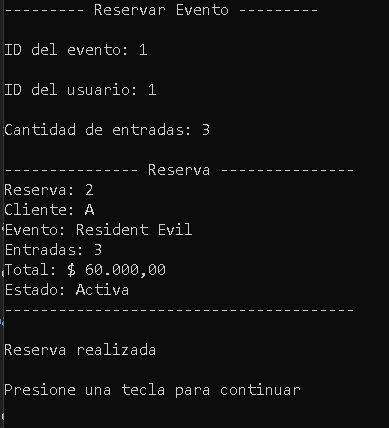

### Caso 2: reservar más entradas que los cupos disponibles
El sistema rechaza la reserva y muestra el mensaje de error sin cerrar el programa.

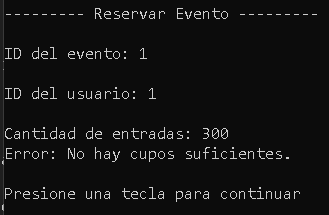

### Caso 3: reservar con una cantidad negativa
El sistema rechaza la cantidad y muestra el mensaje de error.

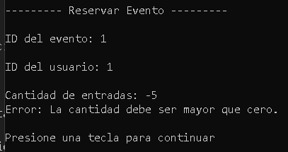

### Caso 4: cancelar una reserva y comprobar que se devuelven los cupos
Se comprueban los cupos antes de cancelar, se cancela la reserva y se verifican de nuevo los cupos, que vuelven a su valor inicial.

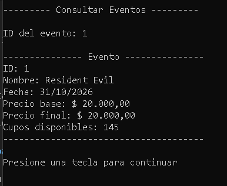
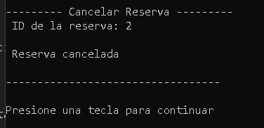
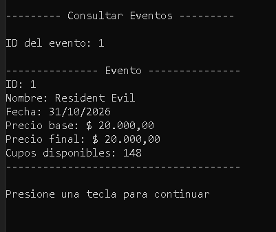

### Caso 5: cancelar dos veces la misma reserva
El sistema impide la segunda cancelación y muestra el mensaje de error.

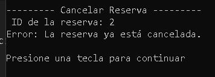

### Caso 6: consultar un evento inexistente
El sistema informa que el evento no existe y el programa sigue funcionando.

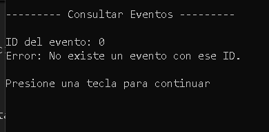

### Caso 7: precio final de cada tipo de evento
Cada tipo de evento calcula su precio final con su propia regla (polimorfismo).

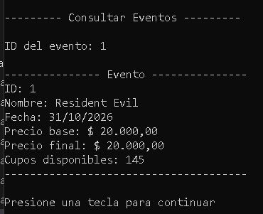
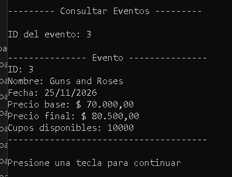
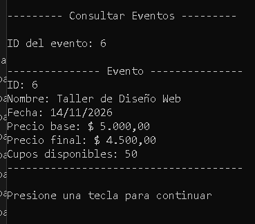
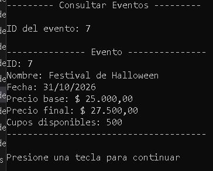

## Diagrama UML

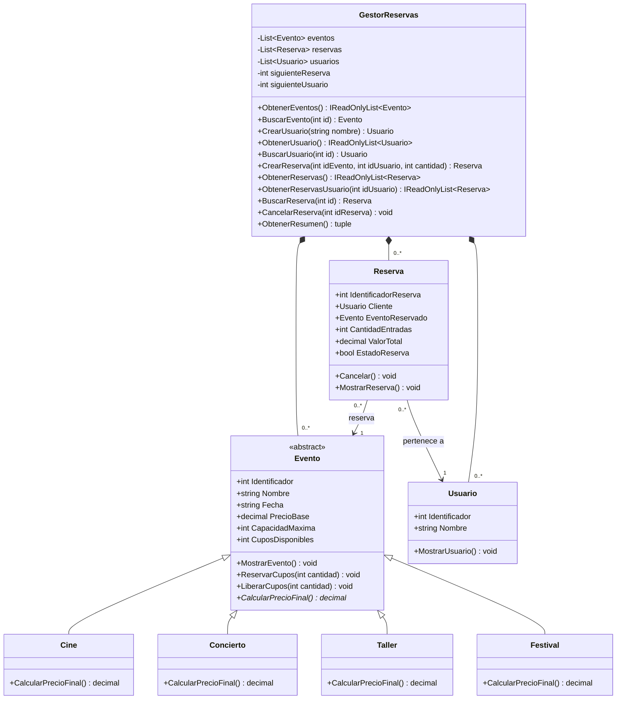
